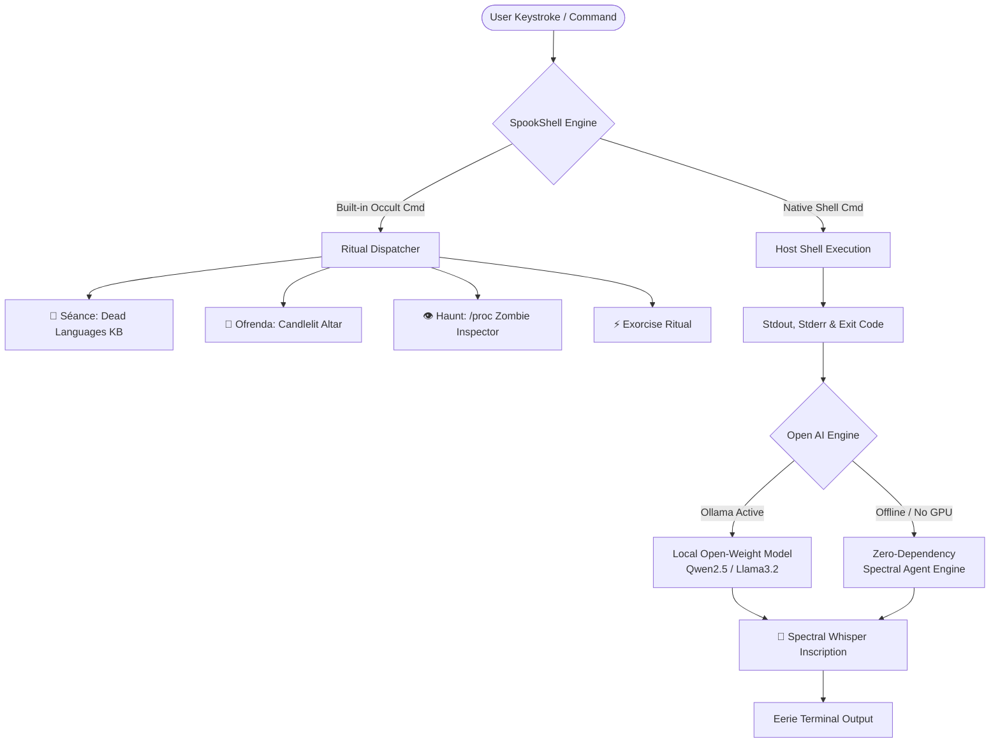

# 👻 SpookShell: The Haunted Terminal & Digital Ofrenda Séance

> **A Halloween & Día de los Muertos Open-Source AI Shell Possession Engine.**  
> *Built for the Hacktoberfest 2026 Open-Source AI Challenge: Week 4 ("Ghost in the Machine").*  
> Tag: `#hf26challenge`

```
  .---.                                    .-. .-.       .-. .-.
 /   __\                                   | | | |       | | | |
 |  /  __ .--.   .---.   .---.  | |.-.     | `-' | .-.   | | | |
 | |  |_ |[ '/'\\ / .-. \\ / .-. \\ | /   \\    | .-. |/ .-.\\ | | | |
 |  \\_/  | | |   | '-' | | '-' | |  .-. |   | | | || '-'  | | | |
  \\_____/  '-'    `---'   `---'  `-' `-'   `-' `-' `---`  `-' `-'
         👻 G H O S T   I N   T H E   M A C H I N E 👻
```

---

## 🌟 Why Open Innovation Matters for SpookShell

The challenge prompt asks:
> *"Does it run on a laptop with no internet? Keep someone's data off a server they don't control? Let you fine-tune, swap models, or change how your agent behaves? Cost nothing to run? Tell us where your open-based approach worked better than a closed one."*

Here is why **SpookShell was designed exclusively for open-source AI**:

1. **Complete Terminal Privacy (No Leaking Commands to Cloud APIs)**:  
   A shell tool observes everything you type: file names, directory trees, commit messages, and environment variables. Sending every terminal keystroke or command output to a closed corporate API (like OpenAI or Anthropic) would be an unacceptable security and privacy vulnerability. By running **locally with open-weight models** (such as `Qwen2.5:0.5B`, `Llama-3.2-1B`, `SmolLM`) or via our zero-dependency offline spectral agent, **your shell history never leaves your device**.
2. **Works With the Lights (and Internet) Off**:  
   SpookShell works entirely offline. Whether you are on an airplane, in a remote cabin, or in a basement with severed fiber, the ghost continues to haunt your terminal with zero latency.
3. **Zero Cost & Sovereign AI**:  
   There are no token costs, subscription tiers, or rate limits. You can run 100,000 commands without spending a penny.
4. **Model Swappability**:  
   SpookShell connects seamlessly to local Ollama endpoints or local inference servers, allowing developers to swap between specialized open weights or adjust sampling parameters on the fly.

---

## 🔮 What SpookShell Does

### 1. 🕯️ Haunted Terminal Possession (REPL & Wrapper)
SpookShell wraps your native Linux/macOS shell. When you run any real command (`ls`, `git`, `rm`, `kill`, `python3`, etc.):
- It executes the real command and preserves real exit statuses.
- The open-source spectral agent inspects the command, output, and return code.
- A **Ghost in the Machine** whispers eerie, funny, or macabre occult commentary directly to your terminal.

```bash
$ python3 spookshell.py ls -la
# ... your directory files listed ...
👻 [Spectral Inscription] Listing directory entries... each file a gravestone in this cold ext4 filesystem.

$ python3 spookshell.py git commit -m "fix typo"
👻 [Spectral Inscription] Another soul committed to the immutable DAG. Your commit hash shall echo into git-reflog eternity.

$ python3 spookshell.py rm -rf /tmp/test
👻 [Spectral Inscription] A merciless purge. You have banished bytes into /dev/null, the bottomless digital purgatory.
```

### 2. 🔮 Digital Séance (`seance <spirit>`)
Summons the spirits of ancient, long-dead programming languages and deprecated software legends:
- **COBOL (1959)**: Demands 80-column alignment, scorns JSON, and balances multi-trillion-dollar nightly batch jobs beneath the earth.
- **Macromedia Flash Player (1996 - 2020)**: Reminisces about Newgrounds, ActionScript 2.0 vector physics, and Steve Jobs' 2010 memo.
- **Clippit (The Assistant)**: The original desktop agent who tapped on your screen glass in 1998.
- **Turbo Pascal (1983)**: Compiled 10,000 lines in 2 seconds on 640KB RAM; strictly enforces semicolons and type safety.
- **GeoCities (1994 - 2009)**: Glitter GIFs, hit counters, and handcrafted personal shrines.
- **ALGOL 60 (1958)**: The mother of all block-structured programming (`begin ... end`).

```bash
$ python3 spookshell.py seance cobol "How do I modernize my backend?"
# Outputs an authentic, nostalgic, and humorous response in the voice of COBOL!
```

### 3. 🌼 Día de los Muertos Candlelit Ofrenda (`ofrenda`)
An ASCII/ANSI altar honoring fallen open-source heroes and software pioneers. Features:
- Digital offerings of **Flor de Cempasúchil** (marigolds), **Pan de Muerto**, **Vaso de Agua**, and **3.5" Floppy Disks**.
- Interactive custom offering placement (`ofrenda offer A vintage IBM Model M keyboard`).
- Remembrance tiers for pioneers like Grace Hopper, Margaret Hamilton, Dennis Ritchie, and Ada Lovelace.

### 4. 👁️ Real Ghost Process Scanner (`haunt`)
Inspects `/proc` on Linux to detect actual **Zombie Processes** (`State: Z / <defunct>`)—processes that have died but whose parent has not yet collected their exit status—along with real memory vitals and CPU load.

### 5. ⚡ The Exorcism Ritual (`exorcise`)
An interactive ANSI command to attempt banishing the spirit... though the ghost will remind you that it runs in ring 0 and setsid() ignores your mortal signals!

### 6. 🌐 Companion Web Ofrenda (`web_ofrenda.html`)
A standalone, zero-dependency browser interface featuring:
- Procedural **Web Audio API** synthesized spooky ambient drones and chime bells (no external audio files needed).
- Canvas-based falling **Cempasúchil petals** physics.
- Interactive candles with flickering CSS flames.
- Live Web Séance terminal.

---

## 🚀 Quickstart Guide

### Requirements
- Python 3.8+ (Linux, macOS, or Windows)
- *(Optional)* [Ollama](https://ollama.ai) running locally for open-weight models (`ollama run qwen2.5:0.5b` or `llama3.2`).  
  *If Ollama is not running, SpookShell automatically uses its built-in zero-dependency Offline Spectral Agent Engine!*

### Installation & Launch

```bash
# Clone the repository
git clone https://github.com/NICKSTER0506/SpookShell.git
cd SpookShell

# Make executable
chmod +x spookshell.py

# Launch the interactive haunted shell
./spookshell.py

# Or run a single command in ghost mode
./spookshell.py git status
./spookshell.py seance cobol "Explain recursion"
./spookshell.py ofrenda
./spookshell.py haunt
```

To launch the Web Ofrenda in your browser:
```bash
./spookshell.py web
# Or open web_ofrenda.html directly in any browser!
```

---

## 🏛️ System Architecture



---

## 📜 License
MIT License. Built with love, candlelight, and open-source spirit for Hacktoberfest 2026.
